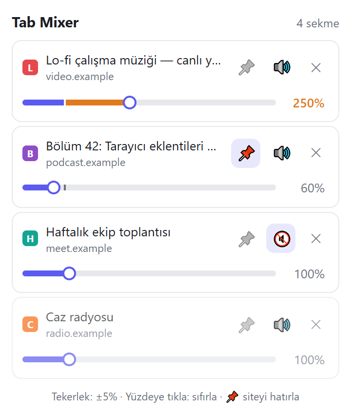
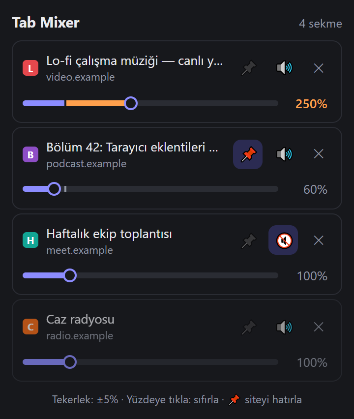
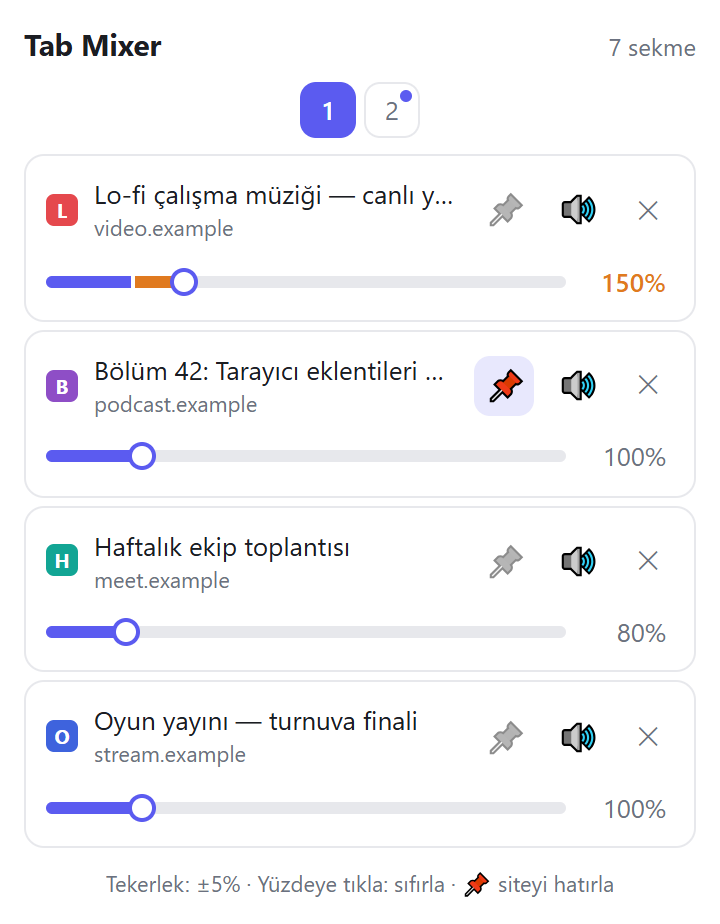

<p align="center">
  
</p>

<h1 align="center">Tab Mixer</h1>

<p align="center">
  Chrome, Brave ve Firefox için sekmeler arası ses mikseri.<br />
  Her sekmenin sesini ayrı ayrı kıs, %600'e kadar güçlendir, sessize al veya kapat.
</p>

<p align="center">
  
  &nbsp;
  
</p>

## Özellikler

- **Ses çalan sekmelerin listesi:** Ses çalan ya da bu oturumda çalmış sekmeler, ses çalanlar en üstte. Satıra tıklayınca o sekmeye geçilir.
- **Sekme başına ses seviyesi (%0–%600):** Sürgüyle veya fare tekerleğiyle (±%5). Yüzdeye tıklayınca %100'e döner. %100 üzeri turuncu görünür.
- **🔇 Sessize alma** ve **✕ sekme kapatma** doğrudan popup'tan.
- **📌 Siteyi hatırla:** İşaretlenen sitenin ses seviyesi kalıcı olarak saklanır. O siteye açılan yeni sekmeler ve yenilemeler aynı seviyeyle başlar.
- **Araç çubuğu rozeti:** Seviye %100 değilse ikonda yüzde görünür (turuncu: güçlendirilmiş, mor: kısılmış).
- **Klavye kısayolları:** Etkin sekmenin sesi popup açılmadan değiştirilebilir.
- **Sayfalama:** 4'ten fazla sekme varsa liste sayfalara bölünür. Başka sayfada ses çalan sekme varsa o sayfanın numarasında nokta görünür.
- Açık ve koyu tema (sistem ayarını izler).

<p align="center">
  
</p>

> Ekran görüntülerindeki sekmeler örnek veridir.

### Klavye kısayolları

Etkin sekmeye uygulanır.

| Kısayol | İşlem |
|---|---|
| `Alt+Shift+↑` / `Alt+Shift+↓` | Sesi %10 artır / azalt |
| `Alt+Shift+0` | %100'e sıfırla |
| `Alt+Shift+M` | Sessize al / sesi aç |

Değiştirmek için: Chrome `chrome://extensions/shortcuts`, Brave `brave://extensions/shortcuts`, Firefox `about:addons` → ⚙ → *Eklenti kısayollarını yönet*. Başka bir eklenti aynı kısayolu kullanıyorsa tarayıcı atamayabilir; o sayfadan elle atayın.

## Kurulum

Eklenti henüz mağazalarda değil; kaynaktan derleyip yükleyin.

```bash
git clone https://github.com/berkaycinar-dev/tab-mixer.git
cd tab-mixer
npm install
npm run build          # .output/chrome-brave-mv3 → Chrome, Brave (ve diğer Chromium tarayıcılar)
npm run build:firefox  # .output/firefox-mv3      → Firefox
```

- **Chrome / Brave:** `chrome://extensions` (Brave: `brave://extensions`) → *Geliştirici modu*nu açın → *Paketlenmemiş öğe yükle* → `.output/chrome-brave-mv3` klasörünü seçin.
- **Firefox:** `about:debugging#/runtime/this-firefox` → *Geçici eklenti yükle* → `.output/firefox-mv3/manifest.json`. Firefox imzasız eklentiyi yalnızca tarayıcı kapanana kadar tutar.

> Yeniden build aldıktan sonra eklentiyi tarayıcının eklentiler sayfasından **yeniden yükleyin** (↻). Aksi halde popup yeni, arka plan eski sürümde kalır.

## Nasıl çalışır

Tarayıcılar sekme başına ses seviyesi API'si sunmuyor. Bu yüzden Tab Mixer sesi sayfanın içinden ayarlar:

- **Web Audio:** Sayfanın `AudioContext` çıkışları, bağlam başına tek bir ana `GainNode`'dan geçirilir.
- **`<audio>` / `<video>`:** `volume` özelliği sarmalanır. Site kendi değerini görmeye devam eder; gerçek ses `site seviyesi × sekme seviyesi` olur.
- **%100 üzeri:** Uygun medya öğeleri Web Audio'ya alınıp güçlendirilir.

Motor sayfa bağlamında (`MAIN` world) çalışır. Arka planla iletişimi izole bir köprü content script'i üzerinden yapar ve iframe'leri de kapsar.

### İzinler ve gizlilik

| İzin | Neden |
|---|---|
| `tabs` | Sekme listesi, başlık/ikon, sessize alma, sekmeye geçme ve kapatma |
| `scripting` + `<all_urls>` | Ses motorunu sayfalara yerleştirmek (kurulumda açık olan sekmeler dahil) |
| `storage` | Sekme seviyeleri (oturum boyunca) ve 📌 site kayıtları (kalıcı) |

Tab Mixer hiçbir veri toplamaz ve dışarıya istek göndermez. Kayıtlar yalnızca tarayıcının yerel eklenti depolamasında tutulur.

### Bilinen sınırlamalar

- %100 üzeri güçlendirme yalnızca Web Audio'ya alınabilen medyada çalışır: aynı kökenli kaynaklar, `blob:`/MSE (ör. YouTube) veya CORS izinli kaynaklar. DRM'li ve CORS'suz çapraz kökenli medya %100'de sınırlanır.
- Eklenti mağazası, `chrome://` ve `about:` gibi kısıtlı sayfalarda ses seviyesi ayarlanamaz; sessize alma çalışır.
- 📌 ile kaydedilen seviye, aynı sitenin zaten açık olan diğer sekmelerine ancak yenilenince uygulanır.

## Geliştirme

```bash
npm run dev            # Chrome'u eklenti yüklü olarak açar, değişiklikte otomatik yeniler
npm run dev:firefox    # Firefox
npm run compile        # TypeScript kontrolü
npm run zip            # Mağaza / dağıtım zip'leri (.output/*.zip)
npm run zip:firefox
```

[WXT](https://wxt.dev) + [Preact](https://preactjs.com) + TypeScript, Manifest V3.

```
src/
├── entrypoints/
│   ├── background.ts             # Durum, mesajlar, kısayollar, rozet
│   ├── popup/                    # Popup arayüzü (Preact)
│   ├── volume-main.content.ts    # Sayfa bağlamında ses motoru
│   └── volume-bridge.content.ts  # Arka plan ↔ motor köprüsü
└── lib/
    ├── engine.ts                 # Web Audio / medya öğesi kazanç motoru
    ├── messages.ts               # Mesaj tipleri
    └── state.ts                  # Sekme ve site depolaması
scripts/gen-icons.mjs             # public/icon/*.png üretici (bağımlılıksız)
docs/screenshots/                 # README görselleri
```
